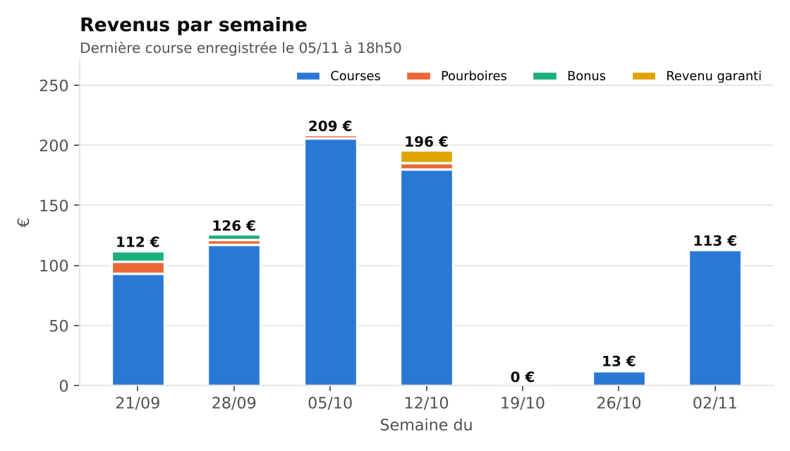
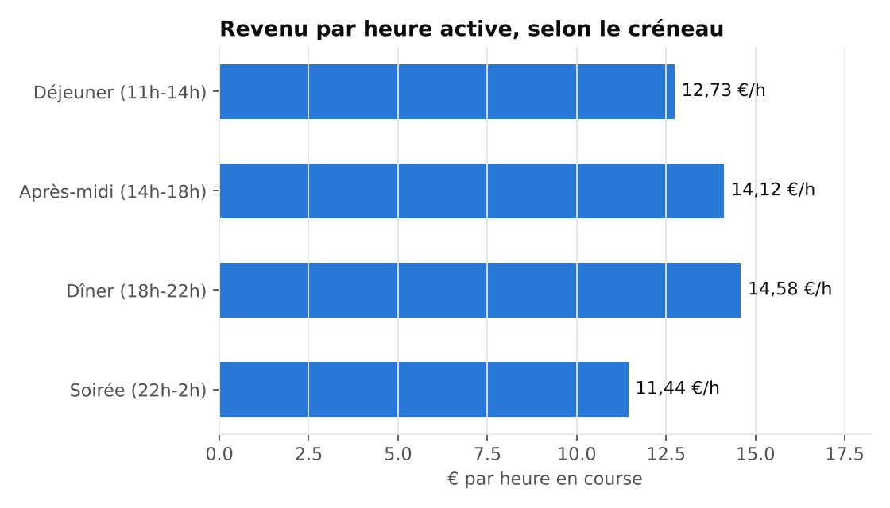
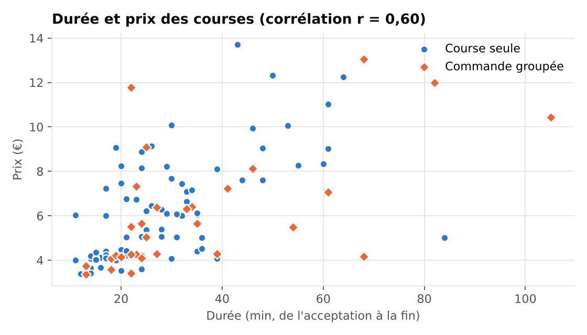

# Analyse de mon activité de livreur Uber Eats

Projet personnel de data analyse réalisé sur mes propres données de livraison (micro-entreprise, Île-de-France).
**Question métier : quand dois-je rouler pour gagner le plus par heure travaillée ?**

**📊 [Voir le dashboard interactif en ligne](https://972-max.github.io/ubereats-analyse/)**



## Contexte

Je livre pour Uber Eats en parallèle de mes études (Mastère Data & IA) et d'un emploi de nuit.
Mon temps disponible est limité : je veux savoir quels créneaux sont les plus rentables, ce qui fait varier le prix d'une course, et si mes revenus progressent.

## Données

| Source | Contenu | Volume |
|---|---|---|
| 7 relevés hebdomadaires Uber (PDF) | Transactions : livraisons, pourboires, bonus, revenu garanti, versements, cotisations URSSAF | 144 transactions |
| Période | 22 septembre – 5 novembre 2026 | 18 journées travaillées |

Les relevés ont été retranscrits en CSV (`data/raw/transactions_uber_brut.csv`), puis contrôlés : **la somme des transactions correspond au centime près au total "Vos revenus" de chaque relevé** (112,39 €, 125,92 €, 208,84 €, 185,15 €, 10,75 €, 12,51 €, 114,10 €).

Les données sont mises à jour à chaque nouveau relevé hebdomadaire. Le dernier relevé (semaine du 2 novembre) est arrêté au 6 novembre.

## Méthode

Pipeline Python (`src/pipeline.py`, Pandas + Matplotlib) :

1. **Contrôle qualité** : doublons, rapprochement des totaux avec les relevés Uber.
2. **Nettoyage** : typage des dates, séparation des types de transactions (livraison, pourboire, bonus, complément de revenu minimum, versement, cotisation URSSAF).
3. **Enrichissement**
   - durée de chaque course (acceptation → fin) ;
   - rattachement des pourboires à leur course (même horodatage de début) ;
   - journée de travail (une course après minuit compte pour la veille) ;
   - créneau horaire : déjeuner, après-midi, dîner, soirée ;
   - détection des **commandes groupées** (courses qui se chevauchent) ;
   - complément de **revenu minimum garanti** rattaché à la semaine qu'il complète, pas à celle où Uber le verse.
4. **Temps actif** : union des intervalles de course par journée, pour ne pas compter deux fois une commande groupée. Il sert à calculer le revenu par heure active.
5. **Exports** : CSV et Excel prêts pour Power BI, graphiques PNG, dashboard interactif.

## Résultats

| Indicateur | Valeur |
|---|---|
| Revenu total | **769,66 €** (courses 723,00 € · pourboires 21,76 € · bonus 13,50 € · revenu garanti 11,40 €) |
| Livraisons | 120 sur 18 journées |
| Temps en course | 55,3 h |
| Revenu par heure active | **13,92 €/h** |
| Prix médian d'une course | 5,29 € |
| Durée médiane d'une course | 24 min |

**1. Le revenu dépend du volume, pas du prix.**

| Semaine du | Livraisons | Revenu | Prix moyen d'une course |
|---|---|---|---|
| 21/09 | 13 | 112,39 € | 7,18 € |
| 28/09 | 18 | 125,92 € | 6,53 € |
| 05/10 | 36 | 208,84 € | 5,72 € |
| 12/10 | 32 | 195,90 € | 5,63 € |
| 19/10 | 0 | 0,00 € | – |
| 26/10 | 2 | 13,16 € | 6,26 € |
| 02/11 (en cours) | 19 | 113,45 € | 5,97 € |

Les meilleures semaines sont celles où j'ai fait le plus de courses, alors que le prix moyen d'une course baisse (de 7,18 € à moins de 6 €). Les bonus Uber ont disparu après septembre ; le revenu minimum garanti a complété la semaine du 12/10 de 10,75 €.

**2. Le déjeuner fait le volume, le dîner paie le mieux à l'heure.**

| Créneau | Livraisons | Revenu par heure active |
|---|---|---|
| Déjeuner (11h-14h) | 51 | 12,73 €/h |
| Après-midi (14h-18h) | 20 | 14,12 €/h |
| Dîner (18h-22h) | 40 | **14,58 €/h** |
| Soirée (22h-2h) | 9 | 11,44 €/h |

Le déjeuner représente 42 % du revenu des courses. Avec plus de données, le dîner passe devant l'après-midi : l'avantage de l'après-midi observé sur les 3 premières semaines (8 courses) ne s'est pas confirmé aussi nettement.



**3. Le prix dépend surtout de la durée.**
Corrélation de 0,60 entre durée et prix : Uber rémunère surtout la longueur de la course. Une course sur quatre (26 %) est une commande groupée.



**4. Les pourboires sont rares.** 5 livraisons sur 120 (4 %), mais un pourboire de 5 à 10 € pèse autant qu'une course.

## Recommandations

- Concentrer les sessions sur le **déjeuner et le dîner du mercredi** (21 et 19 livraisons), puis du mardi.
- Privilégier le **dîner**, le créneau le plus rentable à l'heure ; l'après-midi reste un bon complément.
- Éviter la soirée après 22h, le créneau le moins rentable.
- Viser les créneaux bonus quand Uber en propose : le 24 septembre, ils ont porté la journée à 19 €/h.

## Limites

- Pas de distance, de zone ni de restaurant dans les relevés : impossible de calculer un revenu au kilomètre.
- Le temps d'attente entre deux courses n'est pas connu : le revenu horaire réel est plus bas.
- 120 livraisons, avec des semaines très inégales (aucune course la semaine du 19/10) : ce sont des tendances, pas des certitudes.
- Revenus bruts, avant cotisations URSSAF et frais. Uber prélève directement une partie des cotisations (2,88 € le 2 novembre).

## Suite du projet

- Noter à chaque course les kilomètres et la zone pour calculer le revenu au km.
- Noter l'heure de connexion et de déconnexion pour mesurer le vrai revenu horaire.
- Continuer d'ajouter chaque relevé hebdomadaire et suivre l'évolution dans Power BI.

## Structure

```
ubereats-analyse/
├── data/
│   ├── raw/transactions_uber_brut.csv   # transactions retranscrites des relevés
│   └── processed/                       # livraisons, journées, bonus, créneaux, KPIs
├── src/pipeline.py                      # nettoyage, enrichissement, KPIs, graphiques
├── src/build_site.py                    # génère index.html à partir des données
├── outputs/
│   ├── figures/                         # graphiques PNG
│   └── uber_eats_donnees_powerbi.xlsx   # modèle de données pour Power BI
├── index.html                           # dashboard interactif publié avec GitHub Pages
├── site/template.html                   # modèle de la page (d3.js)
└── docs/guide_powerbi.md                # construire le rapport Power BI pas à pas
```

## Lancer le projet

```bash
pip install -r requirements.txt
python src/pipeline.py      # nettoie les données, calcule les indicateurs, génère les graphiques
python src/build_site.py    # régénère le dashboard en ligne
```

## Outils

Python (Pandas, Matplotlib) · Excel · Power BI · d3.js · Git

---
Nathan Babootarie · Étudiant en Mastère Data & IA, en recherche d'alternance Data Analyst · [LinkedIn](https://linkedin.com/in/nathan-babootarie)
