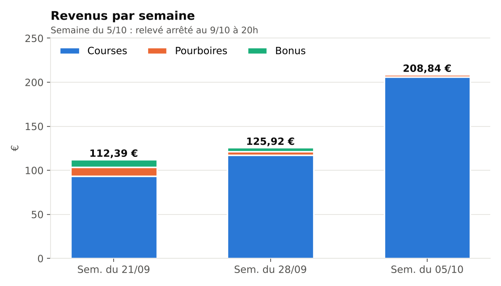
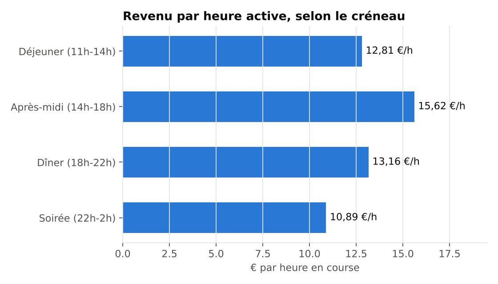
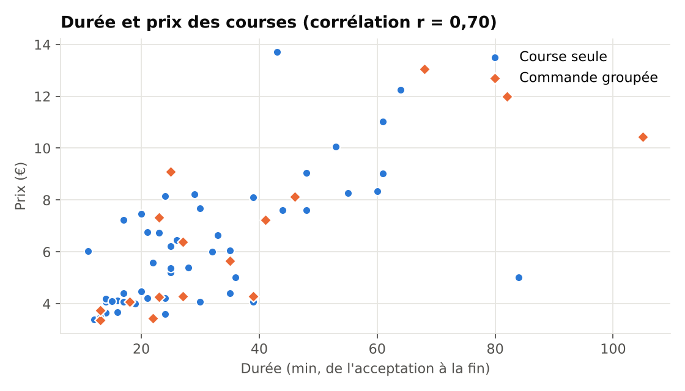

# Analyse de mon activité de livreur Uber Eats

Projet personnel de data analyse réalisé sur mes propres données de livraison (micro-entreprise, Île-de-France).
**Question métier : quand dois-je rouler pour gagner le plus par heure travaillée ?**



## Contexte

Je livre pour Uber Eats en parallèle de mes études (Mastère Data & IA) et d'un emploi de nuit.
Mon temps disponible est limité : je veux savoir quels créneaux sont les plus rentables, ce qui fait varier le prix d'une course, et si mes revenus progressent.

## Données

| Source | Contenu | Volume |
|---|---|---|
| 3 relevés hebdomadaires Uber (PDF) | Transactions : livraisons, pourboires, bonus, versements | 82 transactions |
| Période | 22 septembre – 8 octobre 2026 | 11 journées travaillées |

Les relevés ont été retranscrits en CSV (`data/raw/transactions_uber_brut.csv`), puis contrôlés : **la somme des transactions correspond au centime près au total "Vos revenus" de chaque relevé** (112,39 €, 125,92 €, 208,84 €).

## Méthode

Pipeline Python (`src/pipeline.py`, Pandas + Matplotlib) :

1. **Contrôle qualité** : doublons, rapprochement des totaux avec les relevés Uber.
2. **Nettoyage** : typage des dates, séparation des types de transactions (livraison, pourboire, bonus, complément de revenu minimum, versement).
3. **Enrichissement**
   - durée de chaque course (acceptation → fin) ;
   - rattachement des pourboires à leur course (même horodatage de début) ;
   - journée de travail (une course après minuit compte pour la veille) ;
   - créneau horaire : déjeuner, après-midi, dîner, soirée ;
   - détection des **commandes groupées** (courses qui se chevauchent).
4. **Temps actif** : union des intervalles de course par journée, pour ne pas compter deux fois une commande groupée. Il sert à calculer le revenu par heure active.
5. **Exports** : CSV et Excel prêts pour Power BI, graphiques PNG, dashboard interactif.

## Résultats

| Indicateur | Valeur |
|---|---|
| Revenu total | **447,15 €** (courses 416,89 € · pourboires 16,76 € · bonus 13,50 €) |
| Livraisons | 67 sur 11 journées |
| Temps en course | 33,1 h |
| Revenu par heure active | **13,51 €/h** |
| Prix médian d'une course | 5,58 € |
| Durée médiane d'une course | 25 min |

**1. Le revenu progresse grâce au volume, pas au prix.**
La dernière semaine rapporte 208,84 € (+66 % par rapport à la précédente) avec 36 livraisons contre 18. Dans le même temps, le prix moyen d'une course baisse : 7,18 € → 6,53 € → 5,72 €. Les bonus Uber disparaissent la troisième semaine.

**2. Le déjeuner fait le volume, l'après-midi paie le mieux à l'heure.**

| Créneau | Livraisons | Revenu par heure active |
|---|---|---|
| Déjeuner (11h-14h) | 32 | 12,81 €/h |
| Après-midi (14h-18h) | 8 | 15,62 €/h |
| Dîner (18h-22h) | 23 | 13,16 €/h |
| Soirée (22h-2h) | 4 | 10,89 €/h |

Le déjeuner représente 45 % du revenu des courses. L'après-midi est le plus rentable à l'heure, mais sur 8 courses seulement : à confirmer avec plus de données.



**3. Le prix dépend surtout de la durée.**
Corrélation de 0,70 entre durée et prix : Uber rémunère surtout la longueur de la course. Une course sur quatre (24 %) est une commande groupée.



**4. Les pourboires sont rares.** 4 livraisons sur 67 (6 %), mais un pourboire de 10 € pèse autant qu'une course.

## Recommandations

- Concentrer les sessions sur le **déjeuner et le dîner du mardi et du mercredi**, les créneaux où j'ai le plus de commandes.
- Tester davantage l'après-midi pour vérifier si son meilleur revenu horaire se confirme.
- Éviter la soirée après 22h, le créneau le moins rentable.
- Viser les créneaux bonus quand Uber en propose : le 24 septembre, ils ont porté la journée à 19 €/h.

## Limites

- Pas de distance, de zone ni de restaurant dans les relevés : impossible de calculer un revenu au kilomètre.
- Le temps d'attente entre deux courses n'est pas connu : le revenu horaire réel est plus bas.
- 3 semaines et 67 livraisons : ce sont des tendances, pas des certitudes.
- Revenus bruts, avant cotisations URSSAF et frais.

## Suite du projet

- Noter à chaque course les kilomètres et la zone pour calculer le revenu au km.
- Noter l'heure de connexion et de déconnexion pour mesurer le vrai revenu horaire.
- Ajouter les semaines suivantes et suivre l'évolution dans Power BI.

## Structure

```
ubereats-analyse/
├── data/
│   ├── raw/transactions_uber_brut.csv   # transactions retranscrites des relevés
│   └── processed/                       # livraisons, journées, bonus, créneaux, KPIs
├── src/pipeline.py                      # nettoyage, enrichissement, KPIs, graphiques
├── outputs/
│   ├── figures/                         # graphiques PNG
│   └── uber_eats_donnees_powerbi.xlsx   # modèle de données pour Power BI
├── dashboard/index.html                 # code du dashboard interactif (d3.js)
└── docs/guide_powerbi.md                # construire le rapport Power BI pas à pas
```

## Lancer le projet

```bash
pip install -r requirements.txt
python src/pipeline.py
```

## Outils

Python (Pandas, Matplotlib) · Excel · Power BI · d3.js · Git

---
Nathan Babootarie · Étudiant en Mastère Data & IA, en recherche d'alternance Data Analyst · [LinkedIn](https://linkedin.com/in/nathan-babootarie)
